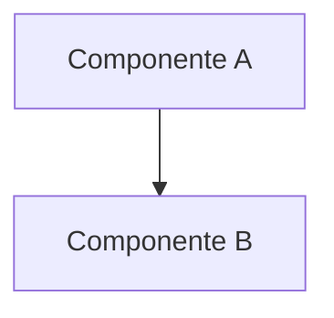

# Light Architecture: {TASK_MANAGER_KEY}

> Template do `/eng.light-arch` (desenho arquitetural leve). Mais curto que o `architecture-template.md`: sem branch, sem PR e sem o plano de testes completo da seção 6.5. Substitua os placeholders `{...}`.

> 📁 **Sessão**: `$SESSIONS_DIR/eng/{TASK_MANAGER_KEY}/`
> 🎫 **Card**: `{TASK_MANAGER_KEY}` ({URL do card}, se houver)

> **Criado em:** {DATA}
> **Commit base:** `{sha}` (no modo workspace, `{repo}@{sha}` por repositório: as linhas citadas nos links são deste commit)
> **Status:** 🔄 Em Revisão | ✅ Aprovado | ❌ Rejeitado
> **Ajustes antes da aprovação:** {0} (soma 1 a cada iteração que o humano pedir, no Exame ou na Arquitetura)

---

## 1. Visão Geral

### 1.1 Contexto

{Por que isso está sendo construído. Pelo card, pelos pais e filhos, e pela conversa do Exame.}

### 1.2 Objetivo

{Qual é o resultado esperado para esta issue, direcionalmente.}

### 1.3 Escopo

**Incluído:**

- {item incluído no escopo}

**Não incluído:**

- {item explicitamente fora do escopo}

---

## 2. Análise Técnica

### 2.1 Estado Atual (As-Is)

{Como o sistema funciona hoje: fluxo, componentes envolvidos.}

### 2.2 Estado Proposto (To-Be)

{Como funcionará depois: a mudança principal.}

### 2.3 Componentes Impactados

> Caminhos como link relativo a este arquivo (`rules-on-demand/doc-links-rules.md`); arquivo ainda não criado fica em texto. `{RAIZ}` é a sequência de `../` até a pasta do workspace, contada para este arquivo (`doc-links-rules.md`, regra 1); troque ao gravar.

| Componente | Caminho | Tipo de Mudança | Descrição da Mudança |
| ---------- | ------- | --------------- | --------------------- |
| {Nome}     | `{path}` | 🆕 Criação      | {descrição}           |
| {Nome}     | [`{path}`]({RAIZ}{repo}/{path}#L{n}) | ✏️ Modificação  | {descrição}           |

### 2.4 Padrões e Convenções a Seguir

| Padrão             | Descrição                      | Referência no Projeto     |
| ------------------ | ------------------------------- | -------------------------- |
| {nome do padrão}   | {breve descrição}               | {caminho/arquivo-exemplo}  |

### 2.5 Premissas e Passe Crítico

> Antes de apresentar o desenho (Passo 5 da Arquitetura): um passe contra o próprio documento. Só entram premissas que mudam o desenho se estiverem erradas.

| Premissa | Fonte | O que a derrubaria | Como conferir |
| -------- | ----- | ------------------- | -------------- |
| {afirmação em que o desenho se apoia} | {lida: [`{arquivo}:{n}`]({RAIZ}{repo}/{caminho}#L{n}) \| presumida} | {fato que, se verdadeiro, invalida a premissa} | {leitura, comando ou pergunta} |

**O que derrubaria este documento:** {a premissa mais frágil, em uma frase}

---

## 3. Decisões Arquiteturais

### 3.1 Decisão: {Título da Decisão}

**Contexto:**
{Por que esta decisão é necessária.}

**Opções Consideradas:**

| Opção   | Descrição | Prós        | Contras     |
| ------- | --------- | ----------- | ----------- |
| Opção A | {desc}    | {vantagens} | {problemas} |
| Opção B | {desc}    | {vantagens} | {problemas} |

**Decisão:** {Opção escolhida}

**Justificativa:**
{Por que esta opção, e o que pesou na decisão.}

**Consequências:**

- {consequência positiva}
- {consequência negativa/trade-off}

---

### 3.2 Decisão: {Outra Decisão se houver}

{Repita a estrutura acima para cada decisão arquitetural importante}

---

## 4. Dependências

### 4.1 Dependências Internas

| Módulo/Componente | Motivo da Dependência | Status |
| ------------------ | ---------------------- | ------ |
| {módulo}           | {por que depende}      | ✅ Existe / 🔄 Em desenvolvimento |

### 4.2 Dependências Externas

| Biblioteca/Serviço | Versão | Motivo                | Já existe no projeto? |
| ------------------- | ------ | ---------------------- | ---------------------- |
| {biblioteca}        | {ver}  | {para que será usada}  | ✅ Sim / ❌ Não        |

### 4.3 Dependências de Outras Tasks

| Task       | Descrição        | Status |
| ---------- | ----------------- | ------ |
| {chave}    | {o que precisa}   | ✅ Concluída / 🔄 Em andamento |

---

## 5. Riscos e Mitigações

| ID  | Risco                | Probabilidade     | Impacto           | Mitigação        | Plano B       |
| --- | --------------------- | ------------------ | ------------------- | ------------------ | --------------- |
| R1  | {descrição do risco}  | Alta/Média/Baixa   | Alto/Médio/Baixo    | {como mitigar}     | {alternativa}   |

---

## 6. Considerações Técnicas

### 6.1 Segurança

- **Dados sensíveis:** {PII, financeiros, credenciais; ou "sem superfície de segurança identificada"}
- **Superfície de ataque:** {endpoints públicos vs. autenticados}
- **Modelo de auth:** {se houver mudança}

### 6.2 Performance

- **Expectativa:** {latência, throughput, se relevante}
- **Pontos de atenção:** {gargalos potenciais}

### 6.3 Escalabilidade

- **Limitações conhecidas:** {lista, se houver}

### 6.4 Observabilidade

- **Logs e métricas:** {o que vale registrar}

### 6.5 Estratégia de Testes (resumida)

> Direcional, não o plano completo do `architecture-template.md`. Detalhar no `eng.plan`, se a feature seguir para lá.

| Tipo de Teste | O que testar | Prioridade |
| -------------- | -------------- | ----------- |
| {Unitário/Integração/E2E} | {o que} | {Alta/Média/Baixa} |

---

## 7. Diagrama

{Explique o diagrama se necessário}

---

## 8. Questões em Aberto

> Tudo que for **diferente do código ou ambíguo no card** vira uma questão aqui. No mínimo 3 opções, mais a **4 — Outra**. O `/eng.light-arch` não usa Advisor: a decisão é sempre a do humano, ao revisar o documento (Passo 6 da Arquitetura). Sem questão em aberto, escreva "Nenhuma" e o motivo em uma frase.
> **Marcação para leitura rápida:** enquanto a questão estiver 🔄 Aberta, a opção assumida ganha ✅ e "(assumida)" no título, e as alternativas ganham 🔄, inclusive a **4 — Outra**; a coluna "Assumido ou decidido" mostra a suposição atual (`✅ {n} — {nome curto}`). Decidida a questão, a opção escolhida ganha ✅ e "(escolhida)" no título, e as demais ganham ❌, inclusive a **4 — Outra**; a coluna passa a mostrar a decisão. Enquanto a questão estiver 🔄 Aberta, "Decisão adotada" fica "— (aguardando decisão)".

| ID | Status                     | Questão                      | Quem responde  | Assumido ou decidido    |
| -- | -------------------------- | ---------------------------- | -------------- | ----------------------- |
| Q1 | {✅ Decidida \| 🔄 Aberta} | {resumo objetivo da questão} | {nome do usuário} | {✅ {n} — {nome curto}} |

### Q1 — {Título da questão}

**Contexto:**
{Explicação do problema e por que a decisão é necessária.}

**Arquivos/componentes envolvidos:**
* [`{símbolo}` (`{arquivo}:{n}`)]({RAIZ}{repo}/{caminho}#L{n}) — {relação com a questão}

**Dúvida:**
{Descrição clara do que precisa ser decidido.}

**Opções:**

**✅ 1. {Opção assumida} (assumida)**
* Como funciona: {descrição}
* Vantagens: {vantagens}
* Desvantagens: {desvantagens}

**🔄 2. {Alternativa}** (mesmo formato)

**🔄 3. {Alternativa}** (mesmo formato)

**🔄 4. Outra**
* Alternativa adicional, se nenhuma das anteriores for a melhor abordagem.

**Sugestão do Agente:**
{recomendação + justificativa técnica, antes de o humano decidir}

**Decisão adotada:**
✅ **{n} — {o que o humano decidiu}**

**Impacto da decisão:**
{consequências para o desenho.}

---

## 9. Referências

- [Card]({URL do card}) · [Documentação relacionada]({caminho relativo a este arquivo ou URL})
- [Código de referência]({RAIZ}{repo}/{caminho}#L{n})

---

## 10. Próximos Passos

Após aprovação deste documento:

1. [ ] {Comando sugerido: `/eng.start`, `/eng.plan` ou implementar direto, conforme o tamanho}

---

## Histórico de Revisões

| Data   | Autor  | Mudança              |
| ------ | ------ | --------------------- |
| {data} | {nome} | Criação do documento  |
